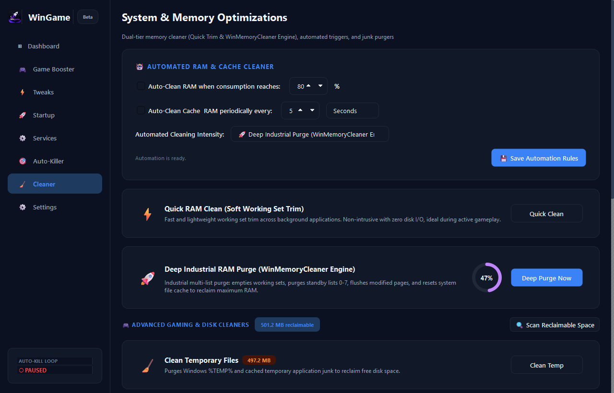
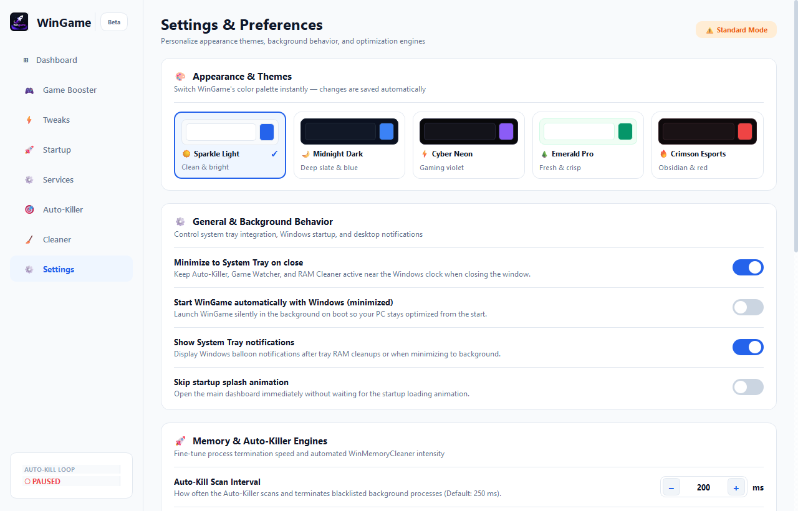

<div align="center">


# WinGame

**Modern Windows 10/11 Gaming & Hardware Optimizer**

[](https://www.microsoft.com/windows)
[](https://www.python.org/)
[](https://www.riverbankcomputing.com/software/pyqt/)
[](https://www.gnu.org/licenses/gpl-3.0)


[](https://github.com/VITTHEO/Wingame/releases)
[](https://github.com/VITTHEO/Wingame/stargazers)

*All-in-one gaming performance dashboard, kernel-level RAM cleaner, reversible Windows tweaker, game booster, and continuous auto-killer.*

</div>

---

## 🎬 Demos

### WinGame — Presentation & Short 9x16

| Presentation (16:9) | Short (9:16) |
| :---: | :---: |
| [](https://www.youtube.com/watch?v=7R1BejNScWg) | [](https://www.youtube.com/shorts/CXWxTwlHdJk) |

## 📸 Screenshots

### Dashboard — Sparkle Light & Midnight Dark
<p align="center">
  
  
</p>

### Windows Tweaks & Debloat (Cyber Neon Theme)
<p align="center">
  
</p>

### Dual-Tier RAM Cleaner & Gaming Disk Cleaners (Midnight Dark)
<p align="center">
  
</p>

### Settings, 5 Live Themes & Global Hotkeys
<p align="center">
  
</p>

---

## ✨ Key Features

### 📊 Real-Time Hardware Dashboard
- Live **CPU, GPU, RAM, OS, and Storage** cards with animated circular gauges and **60-second sparkline history graphs**.
- Live **NVIDIA GPU temperature (°C) & VRAM usage** telemetry (`nvidia-smi` / NVML).
- One-click **⚡ Quick** & **🚀 Deep** RAM clean buttons right on the Memory card.

### 🧠 Dual-Tier RAM Cleaner (WinMemoryCleaner Engine Port)
- **⚡ Quick Clean**: Lightweight Working Set trim + GC with zero disk I/O — safe to trigger mid-game without stuttering.
- **🚀 Deep Industrial Purge**: Direct Python port of [WinMemoryCleaner](https://github.com/IgorMundstein/WinMemoryCleaner)'s native NT kernel engine (`NtSetSystemInformation`) targeting all **7 Windows memory areas**:
  1. Working Sets (`MemoryEmptyWorkingSets` + per-process `EmptyWorkingSet`)
  2. System File Cache (`SystemFileCacheInformation` + `SetSystemFileCacheSize`)
  3. Modified Page List (`MemoryFlushModifiedList`)
  4. Standby List (Priorities 0–7 & Low Priority)
  5. Combined Page List (`SystemCombinePhysicalMemoryInformation`)
  6. Registry Cache (`SystemRegistryReconciliationInformation`)
  7. Modified File Cache (`DeviceIoControl` + `FlushFileBuffers`)
- Automated RAM cleaner triggers by **RAM % threshold** or **periodic timer**.

### ⚡ 22 Reversible Windows Tweaks & Debloat
Inspired by **Sparkle**, **RyTuneX**, and **Winhance** — every tweak reads its live state from Windows and can be reverted cleanly:
- **🎮 Gaming**: Ultimate Performance Power Plan, Game Mode, Disable Xbox GameDVR, HAGS, MMCSS High Priority, 1:1 Raw Mouse Aim, Disable Fullscreen Optimizations.
- **🔒 Privacy & Debloat**: Disable Telemetry, Disable Ads & Silent Bloatware, Disable Bing Start Search, Disable Copilot & AI Recall, Disable UWP Background Apps, Disable Activity History.
- **⚡ System & UI**: Disable CPU Power Throttling, Classic Windows 10 Context Menu, Zero Menu Delay, Disable Sticky Keys Popups, Disable Hibernation, Disable NTFS Last-Access Writes.
- **🌐 Network & Ping**: Disable Network Throttling Index, Disable Nagle's Algorithm (`TCPNoDelay` / `TcpAckFrequency`), Disable P2P Delivery Optimization.
- Includes **🛡️ Windows System Restore Point** creation, **1-Click Gaming / Privacy Presets**, and **↩️ Revert All**.

### 🧹 Advanced Gaming & Disk Cleaners
- **🔍 Scan Reclaimable Space** before cleaning with per-category size badges.
- Cleans **Windows Temp**, **DirectX / NVIDIA / AMD Shader Cache**, **Windows Update Download Cache**, **Prefetch**, **Recycle Bin**, and **DNS Cache**.

### 🎮 Game Booster, Auto-Killer, Startup & Services
- **Game Booster**: Auto-detects Steam / Riot / local games and boosts CPU priority & cleans RAM on game launch.
- **Auto-Killer**: Ultra-fast configurable background loop (default `250 ms`) with PID immunity & process-tree termination.
- **Startup & Services Managers**: Inspect, toggle, or blacklist startup entries and Windows services.

### 🎨 5 Live Themes, Native DWM Titlebar, System Tray & Global Hotkeys
- **5 Instant Themes**: `☀️ Sparkle Light`, `🌙 Midnight Dark`, `⚡ Cyber Neon`, `🌲 Emerald Pro`, `🔥 Crimson Esports` — including native Windows 11 DWM titlebar theming.
- **System Tray & Boot Startup**: Minimizes cleanly to the Windows tray near the clock and supports `--minimized` auto-start with Windows.
- **Global Gaming Hotkeys**:
  - `Ctrl + Shift + R` — Deep Industrial RAM Purge
  - `Ctrl + Shift + Q` — Quick RAM Clean
  - `Ctrl + Shift + K` — Toggle Auto-Killer

---

## 🚀 Installation & Usage

### Option 1 — Windows Installer (Recommended)
Download **`WinGame_Installer.exe`** from the [Latest Release](https://github.com/VITTHEO/Wingame/releases/latest) and run it:
- Installs cleanly to `C:\Program Files (x86)\VIT THEO\Wingame` (fast `--onedir` build).
- Optional automatic Windows startup (minimized), Desktop & Start Menu shortcuts, and built-in Uninstaller.
- Built-in **GitHub Update Checker** notifies you automatically when new versions drop.

### Option 2 — Run from Source
#### Prerequisites
- **Windows 10 / 11** (64-bit recommended)
- **Python 3.10+**

```bash
# 1. Clone the repository
git clone https://github.com/VITTHEO/Wingame.git
cd Wingame

# 2. Install dependencies
pip install -r requirements.txt

# 3. Run WinGame (auto-requests Administrator privileges for full kernel RAM purge & tweaks)
python main.py
```
Or simply double-click **`lancer_wingames.bat`**.

> **Why Administrator privileges?**
> Windows requires `SeProfileSingleProcessPrivilege` and `SeIncreaseQuotaPrivilege` for kernel-level Standby List & System File Cache purging, as well as HKLM Registry tweaks and `nvidia-smi` telemetry.

---

## 🙏 Credits & Open-Source Attribution

- **[WinMemoryCleaner](https://github.com/IgorMundstein/WinMemoryCleaner)** by **Igor Mundstein** (GPL-3.0) — The native NT memory purging engine in [`core/winmemorycleaner.py`](core/winmemorycleaner.py) is a direct Python port of WinMemoryCleaner's `ComputerService.cs`, `Constants.cs`, and `Structs.cs`.

---

## 📄 License

This project is licensed under the **GNU General Public License v3.0 (GPL-3.0)** — see the [GNU GPL v3.0 license](https://www.gnu.org/licenses/gpl-3.0.html) for full details.
