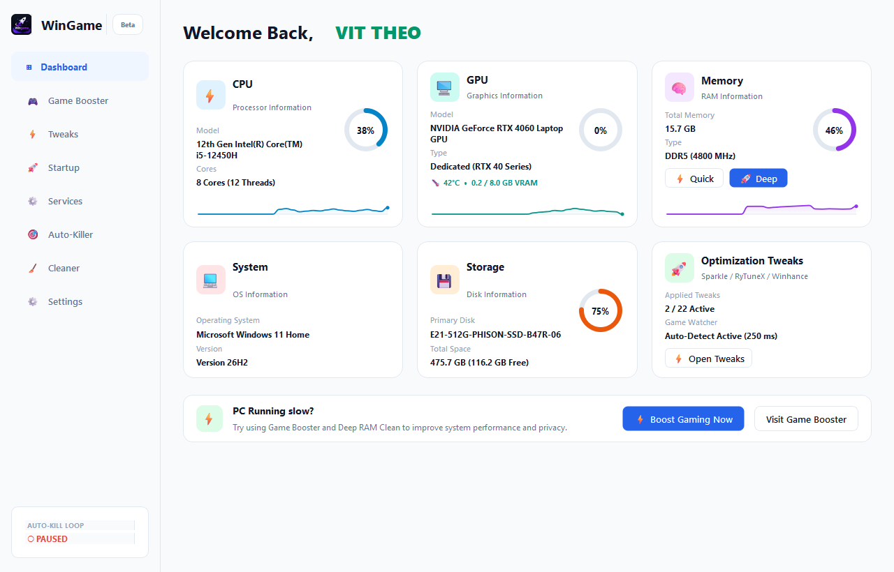
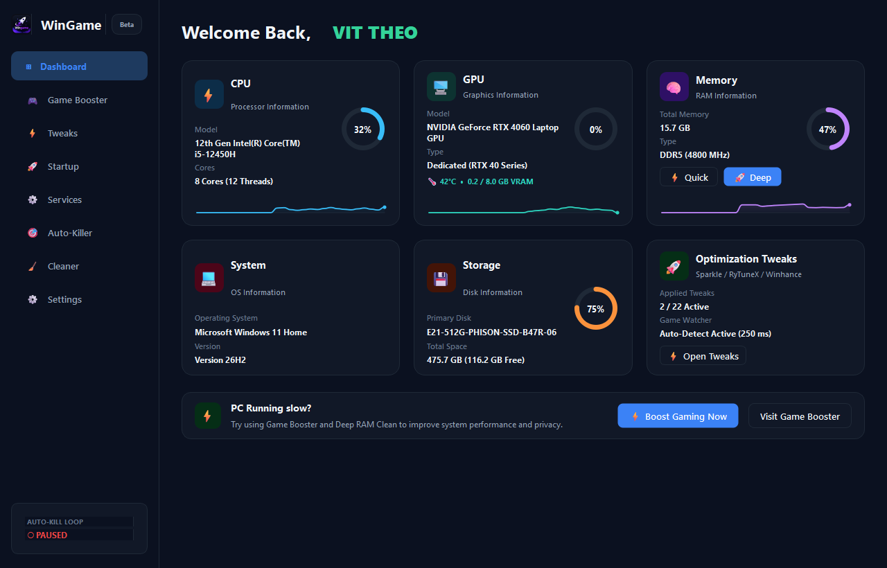
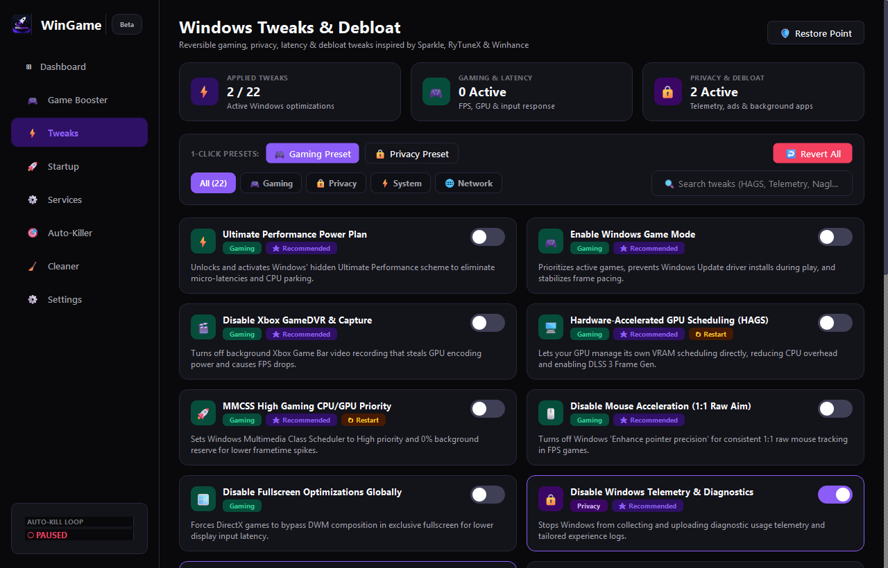

<div align="center">


# Wingame

**Modern Windows 10/11 Gaming & Hardware Optimizer (`BETA-0.17A`)**

[](https://www.microsoft.com/windows)
[](https://www.python.org/)
[](https://www.riverbankcomputing.com/software/pyqt/)
[](https://www.gnu.org/licenses/gpl-3.0)

[](https://apps.microsoft.com/detail/9NCQNRZ9NKRR)
[](https://ez.websr.gg/wingame/)
[](https://ez.websr.gg/wingame/stats/)


[](https://github.com/VITTHEO/Wingame/releases)
[](https://github.com/VITTHEO/Wingame/stargazers)

<br />

<a href="https://apps.microsoft.com/detail/9NCQNRZ9NKRR">
  
</a>

<br />

*All-in-one gaming performance dashboard, kernel-level RAM cleaner, 30 reversible Windows tweaks, redesigned Game Booster, and continuous Auto-Killer.*

</div>

---

## 🎬 Demos

### Wingame — Presentation & Short 9x16

| Presentation (16:9) | Short (9:16) |
| :---: | :---: |
| [](https://www.youtube.com/watch?v=7R1BejNScWg) | [](https://www.youtube.com/shorts/CXWxTwlHdJk) |

## 📸 Screenshots

### Dashboard — Light & Dark Themes
<p align="center">
  
  
</p>

### 30 Reversible Windows Tweaks & Debloat (Purple Theme)
<p align="center">
  
</p>

### Dual-Tier RAM Cleaner & Gaming Disk Cleaners (Dark Theme)
<p align="center">
  
</p>

### Settings, 5 Live Themes, Global Hotkeys & Crash Diagnostics
<p align="center">
  
</p>

---

## ✨ Key Features (`BETA-0.17A`)

### 📊 Real-Time Hardware Dashboard
- Live **CPU, GPU, RAM, OS, and Storage** cards with animated circular gauges and **60-second sparkline history graphs**.
- Live **NVIDIA GPU temperature (°C) & VRAM usage** telemetry (`nvidia-smi` / NVML).
- One-click **⚡ Quick** & **🚀 Deep** RAM clean buttons right on the Memory card.

### 🧠 Dual-Tier RAM Cleaner (WinMemoryCleaner Engine Port)
- **⚡ Quick Clean**: Lightweight Working Set trim + GC with zero disk I/O — safe to trigger mid-game without stuttering.
- **🚀 Deep Industrial Purge**: Direct Python port of [WinMemoryCleaner](https://github.com/IgorMundstein/WinMemoryCleaner)'s native NT kernel engine (`NtSetSystemInformation`) targeting all **7 Windows memory areas**:
  1. Working Sets (`MemoryEmptyWorkingSets` + per-process `EmptyWorkingSet`)
  2. System File Cache (`SystemFileCacheInformation` + `SetSystemFileCacheSize`)
  3. Modified Page List (`MemoryFlushModifiedList`)
  4. Standby List (Priorities 0–7 & Low Priority)
  5. Combined Page List (`SystemCombinePhysicalMemoryInformation`)
  6. Registry Cache (`SystemRegistryReconciliationInformation`)
  7. Modified File Cache (`DeviceIoControl` + `FlushFileBuffers`)
- Automated RAM cleaner triggers by **RAM % threshold** or **periodic timer**.

### ⚡ 30 Reversible Windows Tweaks & Debloat
Inspired by **Sparkle**, **RyTuneX**, and **Winhance** — every tweak reads its live state from Windows and can be reverted cleanly:
- **🎮 Gaming (10)**: Ultimate Performance Power Plan, Game Mode, Disable Xbox GameDVR, HAGS, MMCSS High Priority, 1:1 Raw Mouse Aim, Disable Fullscreen Optimizations, **Disable Multi-Plane Overlay (MPO)**, **Foreground Game CPU Scheduling (`Win32PrioritySeparation 0x26`)**, **Disable Xbox Game Bar Overlay & Controller Hooks**.
- **🔒 Privacy & Debloat (7)**: Disable Telemetry, Disable Ads & Silent Bloatware, Disable Bing Start Search, Disable Copilot & AI Recall, Disable UWP Background Apps, Disable Activity History, **Disable Lock Screen Ads & Fun Facts**.
- **⚡ System & UI (9)**: Disable CPU Power Throttling, Classic Windows 10 Context Menu, Zero Menu Delay, Disable Sticky Keys Popups, Disable Hibernation, Disable NTFS Last-Access Writes, **Disable Windows Fast Startup (Clean Boot)**, **Disable Transparency & Blur Effects**, **Show File Extensions in Explorer**.
- **🌐 Network & Ping (4)**: Disable Network Throttling Index, Disable Nagle's Algorithm (`TCPNoDelay` / `TcpAckFrequency`), Disable P2P Delivery Optimization, **Disable Negative DNS Caching**.
- Includes **🛡️ Windows System Restore Point** creation, **1-Click Gaming / Privacy Presets**, and **↩️ Revert All**.

### 🧹 Advanced Gaming & Disk Cleaners
- **🔍 Scan Reclaimable Space** before cleaning with per-category size badges.
- Cleans **Windows Temp**, **DirectX / NVIDIA / AMD Shader Cache**, **Windows Update Download Cache**, **Prefetch**, **Recycle Bin**, and **DNS Cache**.

### 🎮 Redesigned Game Booster, Auto-Killer, Startup & Services
- **Game Booster**: Modern theme-aware library supporting **Steam, Riot Games, Epic Games & Local games** with crisp auto-cropped game icons, per-game CPU priority & RAM clean profiles, and a **Game Watcher ON / OFF** toggle.
- **Auto-Killer**: Ultra-fast configurable background loop (default `250 ms`) with PID immunity, process-tree termination, and **automatic `explorer.exe` recovery** whenever paused or exited.
- **Startup & Services Managers**: Inspect, toggle, or blacklist startup entries and Windows services.

### 🎨 5 Live Themes, Native Win32 Global Hotkeys & Crash Logger
- **5 Instant Themes**: `☀️ Light`, `🌙 Dark`, `🟣 Purple`, `🟢 Mint`, `🔴 Red` — with native Windows 11 DWM titlebar theming and synced popups.
- **Native Win32 Global Hotkeys** *(with instant Windows Toast notifications)*:
  - `Ctrl + Shift + R` — Deep Industrial RAM Purge
  - `Ctrl + Shift + Q` — Quick RAM Clean
  - `Ctrl + Shift + K` — Toggle Auto-Killer
- **🩺 Crash Logger & 1-Click Diagnostic Report**: Rotating logs in `%APPDATA%\VIT THEO\Wingame\logs\wingame.log` with **Open Logs** and **Copy Bug Report** buttons in **Settings**.
- **📊 Privacy-First Anonymous Stats**: Optional launch/online ping to [ez.websr.gg/wingame/stats](https://ez.websr.gg/wingame/stats/) (version, Windows edition, 2-letter country code, anonymous SHA-256 ID — zero IPs or personal data stored; 1-click opt-out in **Settings** and respects `DO_NOT_TRACK=1`).

---

## 🚀 Installation & Usage

### Option 1 — Microsoft Store (Signed & Auto-Updated)
<a href="https://apps.microsoft.com/detail/9NCQNRZ9NKRR">
  
</a>

- Install directly from the **[Microsoft Store (`9NCQNRZ9NKRR`)](https://apps.microsoft.com/detail/9NCQNRZ9NKRR)**.
- Signed by Microsoft with automatic Store updates and standard-user (`asInvoker`) execution (no UAC prompt on startup).

### Option 2 — GitHub Windows Installer (Full Admin Kernel Features)
Download **`Wingame_Installer.exe`** from the [Latest Release (`BETA-0.17A`)](https://github.com/VITTHEO/Wingame/releases/latest) and run it:
- Installs cleanly to `C:\Program Files (x86)\VIT THEO\Wingame` (fast `--onedir` build with full Administrator kernel RAM purge & `HKLM` tweaks).
- Optional automatic Windows startup (`--minimized`), Desktop & Start Menu shortcuts, built-in Uninstaller, and **GitHub Update Checker**.

### Option 3 — Portable Edition
Download **`Wingame_Portable_BETA-0.17A.zip`** from the [Latest Release](https://github.com/VITTHEO/Wingame/releases/latest), extract, and run **`Wingame.exe`**.

### Option 4 — Run from Source
#### Prerequisites
- **Windows 10 / 11** (64-bit recommended)
- **Python 3.10+**

```bash
# 1. Clone the repository
git clone https://github.com/VITTHEO/Wingame.git
cd Wingame

# 2. Install dependencies
pip install -r requirements.txt

# 3. Run Wingame (auto-requests Administrator privileges for full kernel RAM purge & tweaks)
python main.py
```
Or simply double-click **`lancer_wingames.bat`**.

> **Why Administrator privileges on the GitHub build?**
> Windows requires `SeProfileSingleProcessPrivilege` and `SeIncreaseQuotaPrivilege` for kernel-level Standby List & System File Cache purging, as well as `HKLM` Registry tweaks and `nvidia-smi` telemetry.

---

## 🙏 Credits & Open-Source Attribution

- **[WinMemoryCleaner](https://github.com/IgorMundstein/WinMemoryCleaner)** by **Igor Mundstein** (GPL-3.0) — The native NT memory purging engine in [`core/winmemorycleaner.py`](core/winmemorycleaner.py) is a direct Python port of WinMemoryCleaner's `ComputerService.cs`, `Constants.cs`, and `Structs.cs`.
- **[App-Stats-Tracker](https://github.com/VITTHEO/App-Stats-Tracker)** by **VITTHEO** (MIT) — Lightweight privacy-first anonymous analytics dashboard & Python SDK.

---

## 📄 License

This project is licensed under the **GNU General Public License v3.0 (GPL-3.0)** — see the [GNU GPL v3.0 license](https://www.gnu.org/licenses/gpl-3.0.html) for full details.

